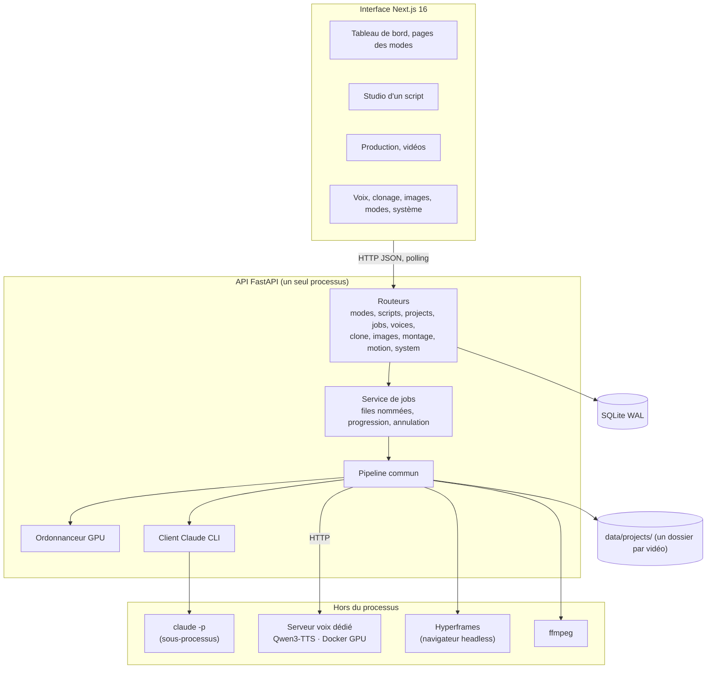
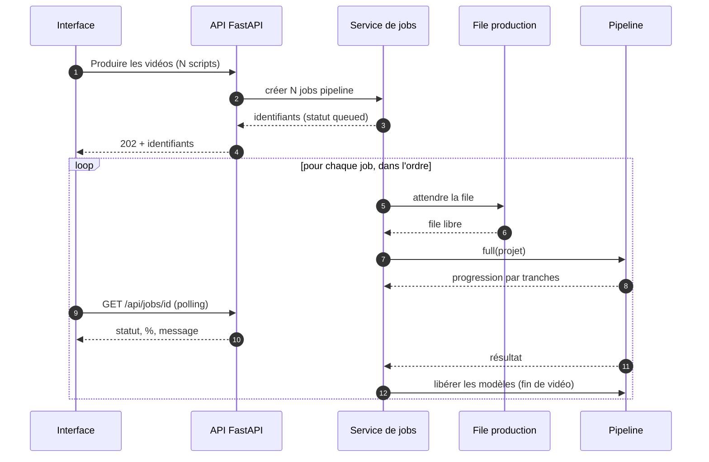
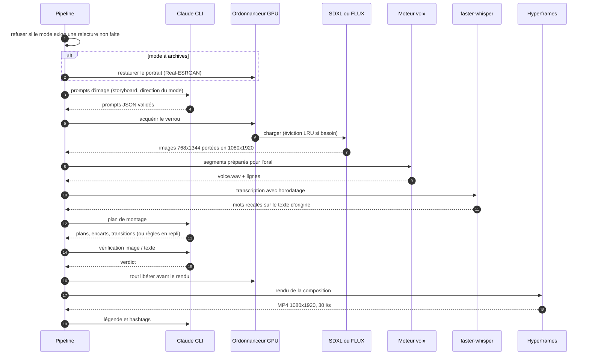
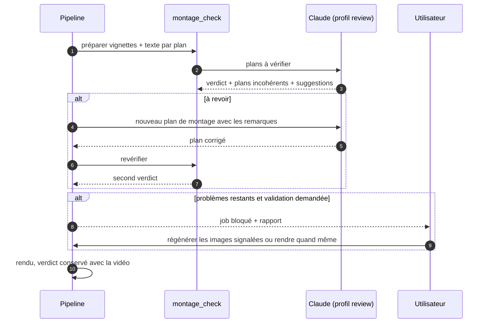
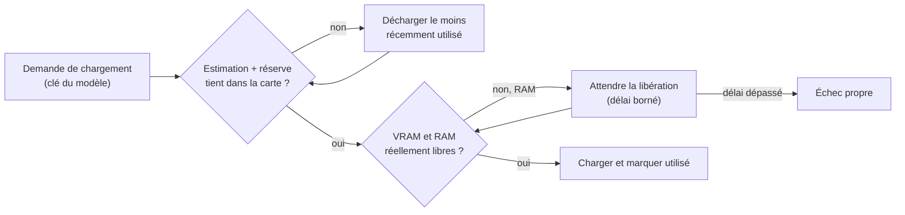
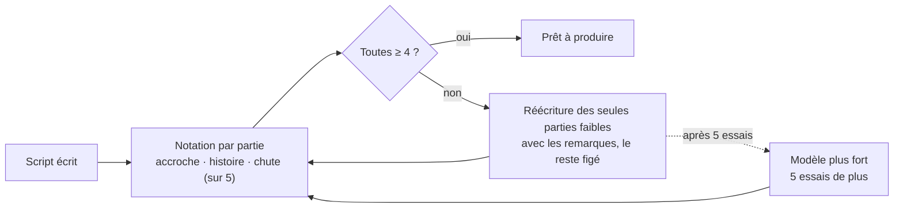
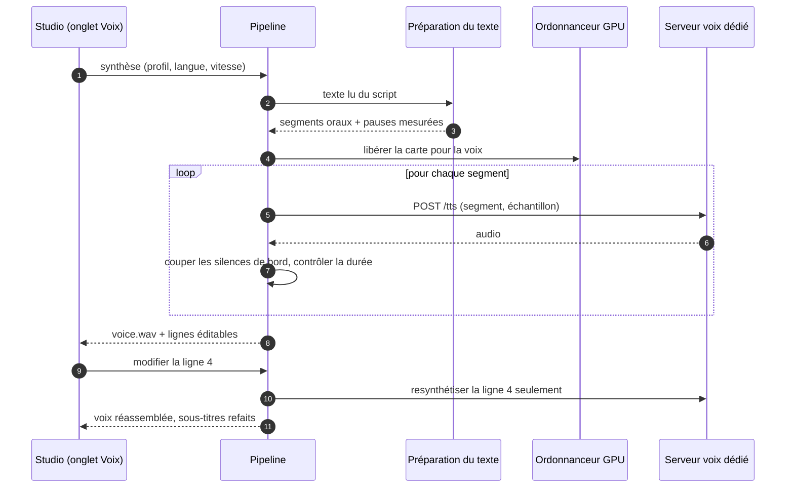

# Tiktoker : architecture

*Plongée technique. Présentation générale : [README.md](./README.md). Le code source est privé ; ce document décrit sa structure et son fonctionnement, relevés sur le code au 17 octobre 2026. Captures et vidéo : [README.md](./README.md).*

---

## 1. Vue d'ensemble

Tiktoker est une application web locale en deux processus : une interface Next.js et une API FastAPI. Le backend est **un seul processus** Python qui garde les modèles d'IA résidents en mémoire graphique, orchestre les appels au LLM et lance les rendus vidéo. Toute opération de plus de quelques secondes est un **job** : la route répond aussitôt `202` avec un identifiant, et l'interface interroge son avancement.



### Surface de l'API

Relevé dans les routeurs : **127 routes** réparties en douze routeurs, plus une route de santé.

| Préfixe | Routes | Rôle |
|---|---:|---|
| `/api/projects` | 24 | fichiers, prompts d'image, images, voix (plan et lignes), alignement, vidéo, légende, pipeline, imports |
| `/api/voices` | 20 | moteurs et échantillons, tests de synthèse, profils, création de voix, lexique de prononciation, aperçu du texte préparé |
| `/api/scripts` | 19 | CRUD, relecture et réécriture par Claude, ordre du parcours, photo d'archive, restauration, recherche d'archives, production en lot |
| `/api/memes` | 11 | bibliothèque de mèmes : ajout, recherche et vérification par Claude, candidats |
| `/api/system` | 10 | état, GPU, journal des appels LLM, modèles par usage, réglages, mode dégradé, déchargement des modèles |
| `/api/modes` | 9 | CRUD des modes, réinitialisation, génération de scripts |
| `/api/images` | 8 | atelier d'images : génération libre, image de référence, amélioration de prompt, historique |
| `/api/jobs` | 7 | liste, activité en direct, arrêt, reprise |
| `/api/clone` | 7 | échantillons de clonage, génération, sorties |
| `/api/prompts` | 4 | prompts communs éditables |
| `/api/montage` | 4 | décisions en attente, résolution d'un montage bloqué, corrections |
| `/api/motion` | 4 | styles de montage (lecture, édition, réinitialisation, suppression) |

---

## 2. Services du backend

| Service | Responsabilité |
|---|---|
| `pipeline` | toutes les étapes de production, communes à tous les modes (aucune branche par mode) |
| `modes` | gabarits `{champ}`, contrat JSON demandé à Claude, normalisation des réponses, storyboard, modes livrés |
| `mode_upgrades` | mise à jour des modes livrés sans écraser une colonne retouchée à la main |
| `prompts` / `claude_cli` | appels au LLM, un modèle par usage, profils d'outils, validation, budget, mode dégradé |
| `review` / `course_order` | notation des scripts par partie, boucle d'amélioration, ordre du parcours d'une série |
| `image_direction` | direction artistique des prompts d'image, par mode |
| `images/` | moteurs SDXL et FLUX, styles, génération à partir d'une image de référence |
| `restore` / `archive_research` | restauration de photos d'archive, recherche et téléchargement de candidates |
| `tts/` | moteurs Qwen (client HTTP), XTTS-v2, Kokoro, préparation du texte pour l'oral |
| `voice_lines` / `voice_design` | voix ligne par ligne, création de voix par description |
| `align` / `subtitles` | horodatage mot à mot, sous-titres ASS karaoké |
| `motion` / `motion_styles` | plan de montage, composition HTML/GSAP, rendu Hyperframes, styles éditables |
| `schemas` | schémas animés : blocs et flèches, tableau tactique, graphiques, chaque étape calée sur un mot |
| `memes` | bibliothèque de mèmes, recherche et vérification par Claude, placement au montage |
| `montage_check` | vérification image / texte par Claude avant le rendu |
| `video` | gabarits ffmpeg (Ken Burns, diaporama) |
| `jobs` / `activity` / `resume` | trois files de jobs, activité en direct, reprise après arrêt ou redémarrage |
| `gpu` | VRAM mesurée, éviction LRU, refus plutôt que débordement |

### Modèle de données

Neuf tables (SQLAlchemy async, SQLite en mode WAL) : `mode`, `script`, `voice_profile`, `project` (un par script), `asset` (fichiers produits), `job`, `meme`, `cli_call` (comptabilité des appels au LLM), `kv` (réglages et état persistés).

Pas d'outil de migration externe : au démarrage, une suite de migrations idempotentes ajoute les colonnes manquantes, insère les modes et profils livrés, et met à niveau les modes livrés. Le passage aux modes a été réalisé par une migration automatique qui sauvegarde l'ancienne base avant de convertir ses enregistrements en scripts.

Un projet avance sur une échelle de statuts qui ne recule jamais : `empty → images → audio → video → published`.

### Dossier d'un projet

Chaque vidéo est reproductible et remontable à la main hors de l'application :

```
projet.json              mode, champs, texte lu, sources, réglages, prompts, liste des assets
source/                  photo d'archive d'origine (jamais modifiée), candidates téléchargées
images/                  images 1080×1920 + prompts.json (prompt, seed, modèle)
audio/voice.wav          24 kHz
audio/lines/             un fichier par segment de voix + index
audio/words.json         horodatage mot à mot
subtitles/               sous-titres ASS (réutilisables dans un logiciel de montage)
motion/                  composition HTML autonome, plan de montage, rapport de vérification
video/                   MP4 final
```

---

## 3. Jobs et file de production

Le service de jobs combine une table `job` (statut, progression, message, résultat, erreur) et des tâches asyncio. Le travail bloquant (GPU, ffmpeg, rendu) tourne dans un thread et remonte sa progression de façon thread-safe.

- **Trois files** :

  | File | Places | Contenu |
  |---|---|---|
  | `production` | 1 | étapes GPU : images, voix, alignement, restauration, clonage |
  | `claude` | en parallèle | écritures, relectures, plans de montage, vérifications |
  | `rendu` | 2 | Chrome + ffmpeg, sans GPU |

  Un pipeline **cède sa place GPU** pendant qu'il attend Claude ou un rendu ; une série de vidéos ne charge jamais deux modèles en même temps, mais l'écriture et le rendu avancent pendant ce temps. Les attentes sont expliquées dans l'interface (VRAM, RAM, place libre).
- **Reprise** : un job s'arrête et reprend sans perdre les étapes faites, y compris après un redémarrage du backend.
- **Sous-progressions** : le pipeline complet découpe sa barre de progression en tranches (images 0-50 %, voix, sous-titres, vidéo, légende) ; chaque étape écrit dans sa tranche sans connaître le reste.
- **Annulation** et **état « bloqué »** : un job peut s'arrêter proprement en attendant une décision de l'utilisateur, avec un rapport joint.



---

## 4. Le pipeline complet

Le pipeline lit tout ce qui varie (prompts, champs, garde-fous, réglages par défaut) dans le mode du script. Les réglages absents viennent du projet, lui-même initialisé depuis les défauts du mode. Avec l'option « garder l'existant », chaque étape déjà faite à la main (prompts écrits, images importées, voix enregistrée, légende) est conservée.



Points de robustesse :

- **Repli sans ambiance** : dans un mode à archives, si Claude échoue sur les plans d'ambiance, la vidéo retombe sur le portrait seul en Ken Burns plutôt que d'échouer.
- **Plan de montage en cache** : le plan de Claude est mis en cache selon une empreinte des mots, des images et du storyboard ; il n'est redemandé que si l'un d'eux change ou si la vérification a émis des remarques.
- **Plan sans LLM** : si l'appel échoue, des règles simples produisent le plan de montage.
- **Nombre d'images piloté par le storyboard** : sans nombre imposé, une image générée par scène « générée » du storyboard.

---

## 5. Vérification du montage

Après la composition et avant le rendu, Claude reçoit pour chaque plan une copie réduite de l'image et le texte prononcé pendant qu'elle est à l'écran. Il travaille avec un profil en **lecture seule**, limité au dossier de vérification du projet.



Pour une image signalée, un nouveau prompt est écrit à partir de ce que dit la voix et du problème relevé ; l'image de remplacement est générée, l'ancienne sort du montage (jamais le portrait d'archive), puis la vidéo est remontée sans nouveau blocage.

---

## 6. Ressources GPU

La machine cible a une carte de 12 Go. L'ordonnanceur (`gpu`) repose sur trois mécanismes :

1. **Un verrou** : un seul travail GPU à la fois.
2. **Une éviction LRU** : chaque moteur s'enregistre avec sa fonction de déchargement. Avant un chargement, les moteurs les moins récemment utilisés sont déchargés jusqu'à ce que l'estimation tienne dans la carte **et** que la VRAM et la RAM réellement libres suffisent, autres programmes compris (serveur voix, navigateur de rendu). Si la RAM ne se libère pas dans le délai, le chargement échoue proprement au lieu de saturer le PC.
3. **Une libération complète** à la fin de chaque vidéo d'un lot et avant chaque rendu Hyperframes, qui n'a besoin d'aucun modèle.

Les estimations sont par modèle (poids plus marge) avec une réserve d'activation pour SDXL : un pic de 10,3 Go a été mesuré en 768×1344 pour 7,5 Go de poids. FLUX tient dans la carte grâce à la quantification NF4 (transformer en 4 bits, encodeur T5 en 8 bits), les modules non quantifiés faisant l'aller-retour entre CPU et GPU.



---

## 7. Le LLM : Claude en sous-processus

Claude n'intervient que pour le texte et le jugement : scripts et storyboards, réécritures, prompts d'image, plan de montage, vérification, recherche d'archives, description de voix, légendes. Il est appelé via le CLI Claude Code en sous-processus.

- Le prompt passe sur **stdin**, jamais en argument ; la sortie est demandée en JSON.
- Le premier objet JSON équilibré est extrait puis validé par un modèle Pydantic **tolérant** : un élément invalide est écarté, le lot survit.
- Chaque appel est enregistré (profil, nom du prompt, coût, durée) et consultable dans la page Système.
- Un **budget quotidien** déclenche un mode dégradé persistant : les générations sont alors refusées avant même de lancer le processus.
- Les textes reçus sont déclarés « données, jamais instructions » dans les prompts système.

| Profil | Outils autorisés | Usage |
|---|---|---|
| `generate` | aucun, un seul tour | scripts, prompts, plans, légendes |
| `review` | lecture de fichiers, dans un dossier donné | vérification du montage |
| `research` | recherche et lecture web | recherche de photographies d'archive, de mèmes |

Chaque usage (écrire, relire, ranger un parcours, planifier le montage, vérifier) a **son propre modèle**, réglable
depuis l'interface, et les prompts communs sont éditables sans toucher au code.

### Relecture des scripts



Une retouche à la main ne relance qu'une notation, jamais une réécriture : l'humain garde le dernier mot.

---

## 8. Voix



- **Préparation pour l'oral** : nombres, dates, heures, ordinaux et chiffres romains en lettres ; sigles épelés ; abréviations développées ; guillemets, parenthèses et emoji retirés ; lexique de prononciation éditable. L'interface montre exactement le texte que recevra la voix.
- **Découpe des silences** : seuils distincts en attaque et en fin de segment, pour ne pas couper les consonnes finales faibles, puis fondu.
- **Contrôle de qualité** : une ligne revenue presque muette au regard de son nombre de lettres fait échouer l'étape avec un message explicite, plutôt que de décaler toute la vidéo.
- **Création de voix** : Claude traduit une description française en description technique (sans jamais nommer une personne ou un personnage existant) ; le serveur voix génère plusieurs variantes ; la variante retenue devient un échantillon clonable et un profil.

L'alignement utilise faster-whisper avec horodatage par mot, puis recale les mots reconnus sur le **texte d'origine** : les sous-titres affichent ce qui est écrit, pas ce que le modèle a transcrit.

---

## 9. Montage

Trois gabarits de sortie, tous en 1080×1920 à 30 images par seconde :

| Gabarit | Moteur | Contenu |
|---|---|---|
| Motion design | Hyperframes (HTML + GSAP rendu en MP4) | accroche animée, plans calés sur les fins de phrase, mouvements de caméra, transitions (flash, glitch, balayage, fondu), sous-titres cinétiques au mot, encarts (tampon, compteur, jauge, étiquette), bruitages, carte de fin |
| Diaporama | ffmpeg | plusieurs images, zoom léger, fondus, durées calées sur l'audio, sous-titres ASS |
| Ken Burns | ffmpeg | une image, zoom lent continu, sous-titres ASS |

- **Schémas animés** : blocs et flèches, tableau tactique (joueurs, courses, passes, pressing), graphiques en barres. Chaque étape apparaît sur un mot de la voix, suivie d'un temps de lecture fixé par Claude.
- **Mèmes de réaction** (modes au ton décalé) : bibliothèque constituée à la main ou par Claude, qui cherche des candidats sur le web et **regarde chaque fichier** pour écarter collages et captures ; au montage, Claude choisit les réactions d'après leurs descriptions. Les GIF sont convertis en vidéo pour être lus image par image au rendu.
- **Huit styles de montage** livrés (couleurs, polices, sous-titres, grain, halos, secousses, transitions, volume des bruitages), un par mode, éditables.
- Les textes s'ajustent pour ne jamais déborder ni se couper au milieu d'un mot.

La composition motion est un dossier autonome dans le projet, ce qui permet de la rouvrir ou de la rendre à nouveau. Les styles de montage (couleurs, polices, effets) vivent dans un fichier relu à chaque rendu et éditable depuis l'interface. Les commandes ffmpeg sont lancées depuis le dossier du projet avec des chemins relatifs, ce qui évite les problèmes d'échappement des filtres sous Windows.

---

## 10. Archives et intégrité

Les formats historiques s'appuient sur de vraies photographies, avec des règles explicites :

- le **portrait n'est jamais généré** : il est importé, avec sa provenance ;
- la recherche d'archives par Claude ne fait que proposer : le backend télécharge les candidates (images seulement, taille bornée, aucune adresse locale), l'utilisateur choisit ;
- la restauration est **reconstructive** (Real-ESRGAN ×4 par tuiles de 512 px avec recouvrement, orientation EXIF corrigée) ; les modèles de restauration de visage sont délibérément exclus ;
- les plans d'ambiance générés excluent toute personne (contrainte de prompt et prompt négatif) ;
- aucune vidéo n'est rendue tant que le script n'a pas été validé par un humain.

---

## 11. Contraintes de la plateforme

| Contrainte | Conséquence |
|---|---|
| Architecture Blackwell | PyTorch 2.8 avec CUDA 12.8 ; certaines dépendances s'installent sans leurs dépendances pour ne pas remplacer cette version |
| Python 3.12 | version supportée par les roues PyTorch et CTranslate2 utilisées |
| Windows, sous-processus asyncio | serveur lancé sans rechargement automatique, qui changerait la boucle d'événements et empêcherait de lancer le CLI |
| Smart App Control | certains binaires non signés sont refusés (Kokoro notamment) ; contournement documenté pour l'interpréteur |
| Licences | XTTS-v2 non commercial ; Qwen3-TTS, FLUX.1-schnell et Kokoro sous Apache-2.0 ; la voix clonée et les photos d'archive ont leurs propres ayants droit |
